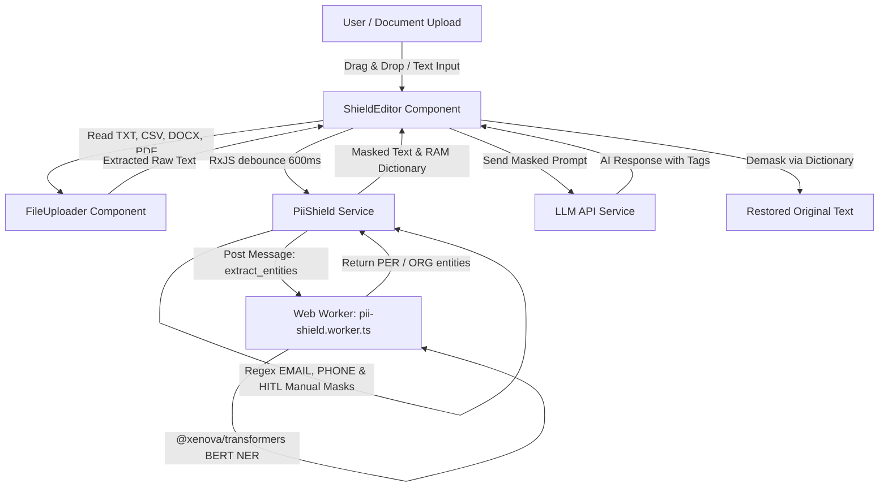

# 🛡️ PII-Shield: إخفاء بيانات الهوية على جانب العميل وبوابة الذكاء الاصطناعي

> حالة الترجمة: مسودة بمساعدة الذكاء الاصطناعي، بانتظار مراجعة لغوية بشرية.

[English](README.md) · [Türkçe](README.tr.md) · [Deutsch](README.de.md) · [العربية](README.ar.md)

**PII-Shield** تطبيق ويب يضع الخصوصية أولاً ويعمل بالكامل على جانب العميل. يكتشف المعلومات الشخصية القابلة للتعريف ويخفيها في المتصفح قبل إرسال طلبات المستخدم ووثائقه إلى نماذج اللغة الكبيرة مثل Gemini وOpenAI. لا يحتاج إلى خادم خلفي ويستخدم Web Workers وTransformers في المتصفح بهدف منع خروج البيانات الحساسة غير المخفية من الجهاز.

## 🚀 الميزات
- **تنفيذ محلي بالكامل:** المعالجة في ذاكرة المتصفح؛ لا اعتماد على خادم ولا إرسال إلى قواعد بيانات خارجية.
- **تحليل صيغ متعددة:** سحب وإفلات ملفات TXT وCSV وDOCX (mammoth.js) وPDF (pdf.js).
- **اكتشاف هجين للكيانات (NER):** نموذج BERT عبر @xenova/transformers يكتشف الأشخاص (PER) والمؤسسات (ORG)؛ التعبيرات النمطية تلتقط البريد الإلكتروني وأرقام الهاتف.
- **مراجعة بشرية (HITL):** مراجعة القناع في قاموس محلي وإزالة النتائج الإيجابية الكاذبة وإضافة أقنعة يدوية قبل الاستعلام.
- **إزالة القناع:** استبدال الرموز مثل [PERSON_1] في الرد بالقيم الحساسة الأصلية.

## 🧠 البنية

## الترخيص
**GNU Affero General Public License v3.0 (AGPL-3.0)**؛ انظر [LICENSE](LICENSE). تقبل المساهمات بموجب الترخيص نفسه. يجب أن تحفظ النسخ المعدلة المشمولة أحكام AGPL-3.0 بما فيها إتاحة المصدر عند التفاعل الشبكي.