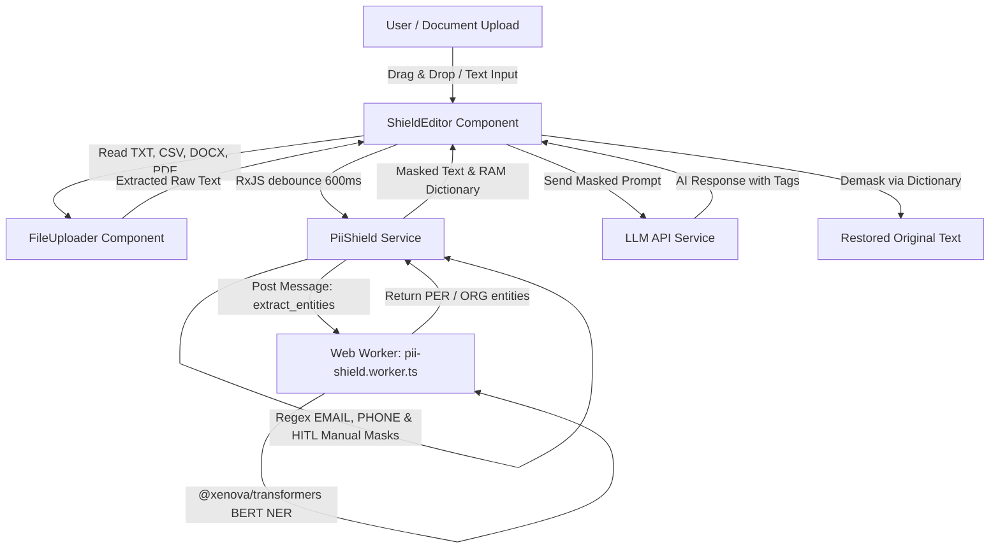

# 🛡️ PII-Shield: Clientseitige PII-Maskierung und KI-Gateway

> Übersetzungsstatus: KI-unterstützter Entwurf, menschliche Sprachprüfung ausstehend.

[English](README.md) · [Türkçe](README.tr.md) · [Deutsch](README.de.md) · [العربية](README.ar.md)

**PII-Shield** ist eine datenschutzorientierte, vollständig clientseitige Webanwendung, die personenbezogene Informationen (PII) im Browser erkennt und maskiert, bevor Prompts und Dokumente an große Sprachmodelle (z. B. Gemini, OpenAI) gesendet werden. Ohne Backend nutzt sie Web Workers und browserinterne Transformers, um zu verhindern, dass unmaskierte sensible Daten das Gerät verlassen.

## 🚀 Funktionen
- **Vollständig clientseitig:** Verarbeitung lokal im Browser-RAM; keine Serverabhängigkeit oder Übertragung an externe Datenbanken.
- **Mehrformat-Dokumentanalyse:** Drag & Drop für TXT, CSV, DOCX (mammoth.js) und PDF (pdf.js).
- **Hybride Entitätserkennung (NER):** @xenova/transformers erkennt Personen (PER) und Organisationen (ORG) mit einem BERT-Modell im Browser; reguläre Ausdrücke erfassen E-Mail-Adressen und Telefonnummern.
- **Menschliche Kontrolle (HITL):** Masken im lokalen Wörterbuch prüfen, falsch positive Treffer entfernen und eigene Masken vor der KI-Anfrage hinzufügen.
- **Demaskierung:** Platzhalter wie [PERSON_1] in LLM-Antworten werden durch ursprüngliche sensible Werte ersetzt.

## 🧠 Architektur

## Lizenz
**GNU Affero General Public License v3.0 (AGPL-3.0)**; [LICENSE](LICENSE). Beiträge werden unter derselben Lizenz angenommen. Modifizierte erfasste Versionen müssen die AGPL-3.0-Bedingungen einschließlich der Quellcode-Verfügbarkeit bei Netzwerkinteraktion wahren.