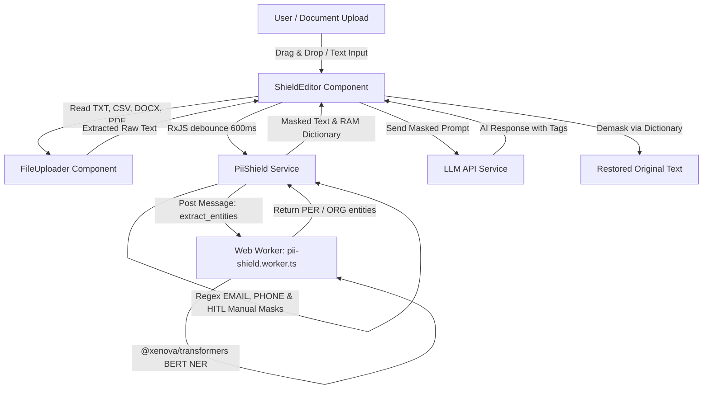

# 🛡️ PII-Shield: Client-Side PII Masking & AI Gateway

[English](README.md) · [Türkçe](README.tr.md) · [Deutsch](README.de.md) · [العربية](README.ar.md)

**PII-Shield** is a privacy-first, 100% client-side web application that detects and masks Personally Identifiable Information (PII) directly in the browser before sending user prompts and documents to Large Language Models (e.g., Gemini, OpenAI).

Operating entirely without a backend server, it acts as a secure local gateway using Web Workers and in-browser Transformers to ensure no unmasked sensitive data ever leaves your device.

---

## 🚀 Features

* **100% Client-Side Execution:** All data processing happens locally in the user's browser (RAM). Zero server dependency and no data is sent to external databases.
* **Multi-Format Document Parsing:** Supports drag-and-drop text extraction for `.txt`, `.csv`, `.docx` (via mammoth.js), and `.pdf` (via pdf.js).
* **Hybrid Entity Detection (NER):** 
  * *AI-Powered:* Detects Persons (PER) and Organizations (ORG) using `@xenova/transformers` (browser-based BERT model).
  * *Rule-Based (Regex):* Instantly captures standard formats like Email addresses and Phone numbers.
* **Human-in-the-Loop (HITL):** Review automatically detected masks in a local dictionary. You can easily remove false positives or manually highlight and add custom masks before querying the AI.
* **Seamless Demasking:** Automatically restores placeholder tags (e.g., `[PERSON_1]`) in the LLM's response back to their original sensitive values, providing a fully legible final output.

---

## 🧠 Architecture Overview

The following diagram illustrates how PII-Shield isolates and processes data entirely on the client side:

---

## License

PII-Shield is licensed under the **GNU Affero General Public License v3.0 (AGPL-3.0)**. See `LICENSE`.

Contributions are accepted under the same license. Modified covered versions must preserve the AGPL-3.0 terms, including the source-availability obligations that apply to network interaction.
