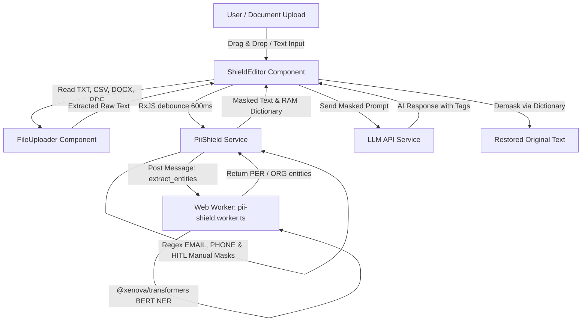

# 🛡️ PII-Shield: İstemci tarafında kişisel bilgi maskeleme ve yapay zekâ ağ geçidi

> Çeviri durumu: Yapay zekâ destekli taslak; insan dil incelemesi bekliyor.

[English](README.md) · [Türkçe](README.tr.md) · [Deutsch](README.de.md) · [العربية](README.ar.md)

**PII-Shield**, kullanıcı istemlerini ve belgelerini büyük dil modellerine (ör. Gemini, OpenAI) göndermeden önce tarayıcıda kişisel tanımlayıcı bilgileri (PII) algılayıp maskeleyen gizlilik odaklı, tamamen istemci taraflı bir web uygulamasıdır. Sunucu gerektirmez; Web Workers ve tarayıcı içi Transformers ile maskelenmemiş hassas verilerin cihazdan ayrılmasını önlemeyi hedefler.

## 🚀 Özellikler
- **%100 istemci tarafı:** İşleme tarayıcı RAM'inde gerçekleşir; sunucu bağımlılığı ve harici veritabanına veri gönderimi yoktur.
- **Çok formatlı belge ayrıştırma:** Sürükle-bırak ile TXT, CSV, DOCX (mammoth.js), PDF (pdf.js).
- **Hibrit varlık tanıma (NER):** @xenova/transformers tarayıcı BERT modeli kişi ve kurumları algılar; düzenli ifadeler e-posta ve telefon gibi standart biçimleri yakalar.
- **İnsan incelemesi (HITL):** Yerel sözlükte maskeleri inceleyin, yanlış pozitifleri kaldırın ve yapay zekâya sormadan önce özel maskeler ekleyin.
- **Maskeyi geri açma:** LLM yanıtındaki [PERSON_1] gibi etiketler özgün hassas değerlere dönüştürülür.

## 🧠 Mimari

## Lisans
**GNU Affero General Public License v3.0 (AGPL-3.0)**; [LICENSE](LICENSE). Katkılar aynı lisansla kabul edilir. Değiştirilmiş kapsam içi sürümler, ağ etkileşimine ilişkin kaynak erişilebilirliği dahil AGPL-3.0 koşullarını korumalıdır.